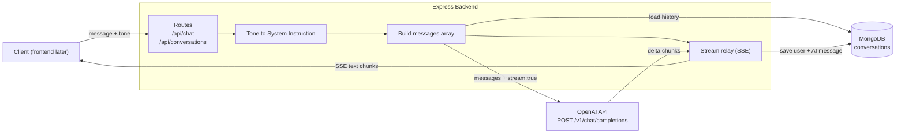
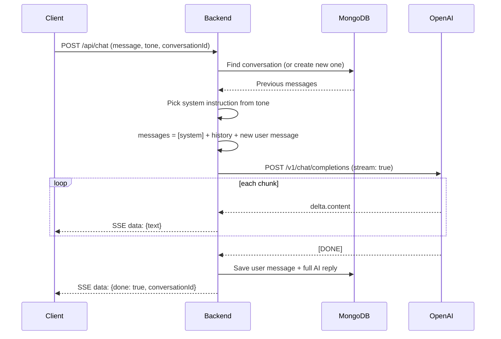
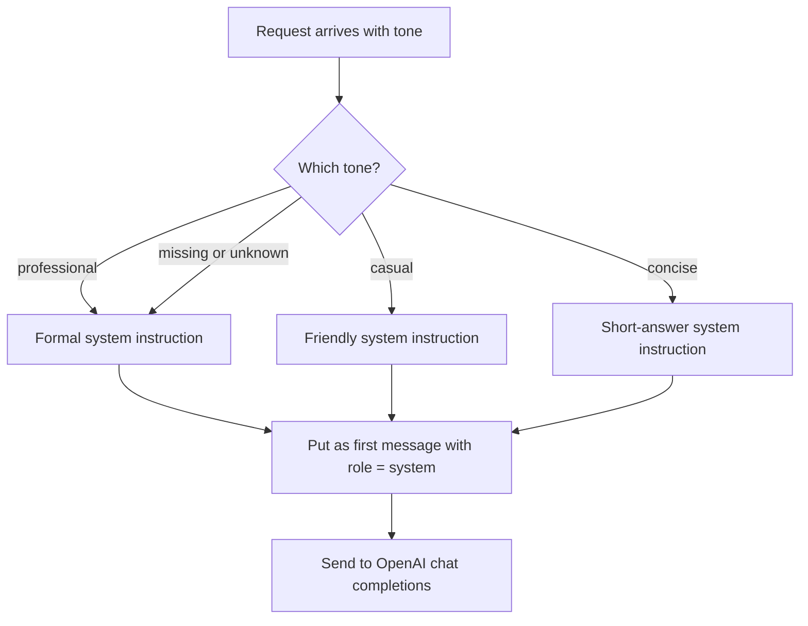
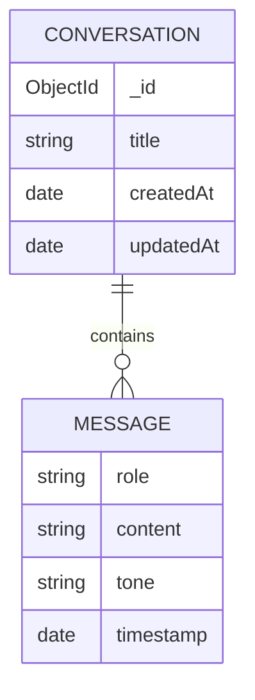
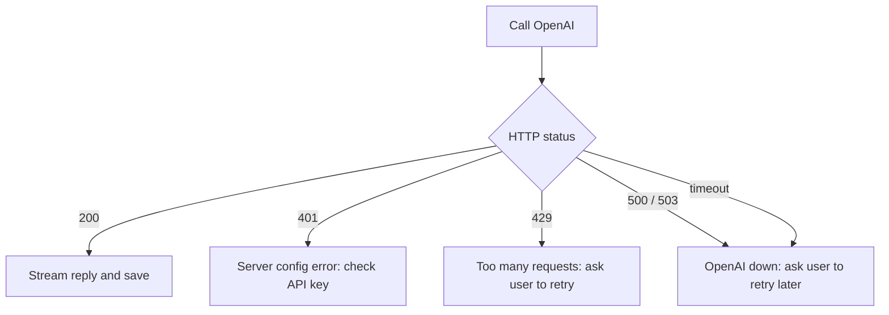

# AI Chat Assistant: Backend Design (OpenAI Mapping)

Scope: backend only. The frontend (chat bubbles, sidebar, typing effect) is left out for now.

Stack: Node.js + Express, MongoDB (Mongoose), OpenAI API.

---

## 1. What the backend must do

| # | Backend feature | Needed because |
|---|-----------------|----------------|
| 1 | Send a user message and get an AI reply | Core chat |
| 2 | Stream the reply piece by piece | "Streaming view" requirement |
| 3 | Apply a tone (Professional / Casual / Concise) | "Tone Toggle" requirement |
| 4 | Remember earlier messages of a conversation | AI needs context to answer follow-ups |
| 5 | Save conversations in MongoDB | "Persistence" requirement |
| 6 | List past conversations and load one | "History sidebar" requirement |
| 7 | Handle API errors (bad key, rate limit, timeout) | Stability |

---

## 2. Feature to OpenAI endpoint mapping

This is the most important part. Only **one** OpenAI endpoint is needed for the whole project:

> `POST https://api.openai.com/v1/chat/completions`

Most features are just different ways of calling that same endpoint. Items 5 and 6 are handled by MongoDB, not OpenAI.

| # | Backend feature | OpenAI endpoint | Request field / response field used | Notes |
|---|-----------------|-----------------|-------------------------------------|-------|
| 1 | Get an AI reply | `POST /v1/chat/completions` | Send `model` + `messages`. Read `choices[0].message.content` | Normal (non-streaming) call |
| 2 | Streaming | `POST /v1/chat/completions` | Add `stream: true`. Read `choices[0].delta.content` from each chunk | Reply arrives as Server-Sent Events, ends with `data: [DONE]` |
| 3 | Tone toggle | `POST /v1/chat/completions` | First item of `messages` is `{ role: "system", content: <tone instruction> }` | System message is rebuilt on every request, so tone changes instantly |
| 4 | Conversation memory | `POST /v1/chat/completions` | Whole history goes in the `messages` array (`user` and `assistant` roles) | The API is stateless, so the backend must resend history every time |
| 5 | Save to MongoDB | none (MongoDB) | n/a | Save after the AI reply finishes |
| 6 | History list / load | none (MongoDB) | n/a | Plain database reads |
| 7 | Error handling | `POST /v1/chat/completions` | Check HTTP status: `401` bad key, `429` rate limit, `500/503` server issue | Return a friendly message to the client |
| 8 | Token usage (optional) | `POST /v1/chat/completions` | `usage.total_tokens` (when streaming add `stream_options: { include_usage: true }`) | Nice to store for cost tracking |
| 9 | Chat title (optional) | `POST /v1/chat/completions` | Second small call: "Make a 4-word title for this message" | Used as the sidebar label |

### Why Chat Completions and not the Responses API?
OpenAI also has a newer `POST /v1/responses` endpoint. Chat Completions is used here because it is simpler, widely documented, and the `messages` array maps directly to what we store in MongoDB.

---

## 3. Tone toggle mapping

The frontend sends one of three values. The backend converts it to a system instruction.

| Tone value | System instruction sent to OpenAI |
|------------|-----------------------------------|
| `professional` | "You are a helpful assistant. Reply in a formal, professional tone with clear and well-structured sentences." |
| `casual` | "You are a helpful assistant. Reply in a friendly, casual tone like talking to a friend." |
| `concise` | "You are a helpful assistant. Reply as briefly as possible. Use at most 2 to 3 short sentences." |

Rules:
- If no tone is sent, default to `professional`.
- If an unknown tone is sent, fall back to `professional`.
- The tone is stored on each message, so old replies keep the tone they were written in.

---

## 4. Our own API (what the frontend will call later)

| Method | Route | Purpose | Uses OpenAI? |
|--------|-------|---------|--------------|
| POST | `/api/chat` | Send a message, stream back the reply, save it | Yes |
| GET | `/api/conversations` | List all conversations for the sidebar | No |
| GET | `/api/conversations/:id` | Load one full conversation | No |
| DELETE | `/api/conversations/:id` | Delete a conversation | No |

### `POST /api/chat`

Request body:

```json
{
  "conversationId": "optional, leave empty for a new chat",
  "message": "Explain what an API is",
  "tone": "casual"
}
```

Response: a Server-Sent Events stream.

```
data: {"text": "An "}
data: {"text": "API "}
data: {"text": "is..."}
data: {"done": true, "conversationId": "665f..."}
```

---

## 5. MongoDB data model

One collection: `conversations`. Each conversation holds its messages in an array.

```json
{
  "_id": "ObjectId",
  "title": "What is an API",
  "createdAt": "2026-10-12T10:00:00Z",
  "updatedAt": "2026-10-12T10:02:00Z",
  "messages": [
    {
      "role": "user",
      "content": "Explain what an API is",
      "tone": "casual",
      "timestamp": "2026-10-12T10:00:00Z"
    },
    {
      "role": "assistant",
      "content": "An API is like a waiter...",
      "tone": "casual",
      "timestamp": "2026-10-12T10:00:03Z"
    }
  ]
}
```

This covers the required fields: timestamp, user prompt, and AI response.

---

## 6. Diagrams

> These use Mermaid. They render on GitHub and in VS Code (install the "Markdown Preview Mermaid Support" extension, then open the Markdown preview).

### 6.1 System overview



### 6.2 One chat request, step by step



### 6.3 Tone toggle flow



### 6.4 Data model



### 6.5 Error handling



---

## 7. Suggested folder structure

```
backend/
  server.js                 // starts Express, connects MongoDB
  .env                      // OPENAI_API_KEY, MONGO_URI, PORT
  models/
    Conversation.js         // Mongoose schema
  routes/
    chat.js                 // POST /api/chat
    conversations.js        // GET / DELETE conversations
  services/
    openai.js               // calls OpenAI chat completions
    tone.js                 // tone to system instruction
```

## 8. Environment variables

| Name | Purpose |
|------|---------|
| `OPENAI_API_KEY` | Secret key for OpenAI (never commit it) |
| `MONGO_URI` | MongoDB connection string |
| `PORT` | Server port, e.g. 5000 |
| `OPENAI_MODEL` | Model name to use (kept in env so it is easy to change) |

---

## 9. Build order (when we start coding)

1. Set up Express + MongoDB connection.
2. Create the `Conversation` model.
3. `tone.js` helper.
4. Non-streaming `POST /api/chat` first (easiest to test).
5. Switch to streaming (`stream: true`).
6. Save messages to MongoDB.
7. History routes (list, load, delete).
8. Error handling.
