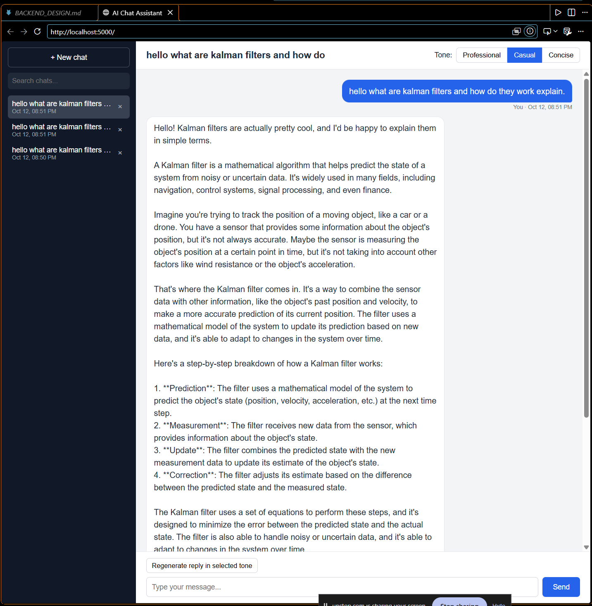
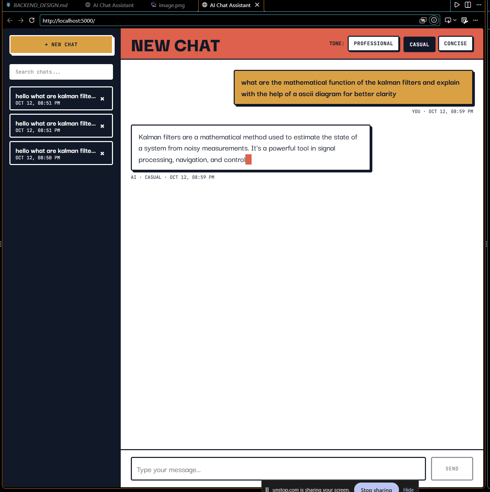
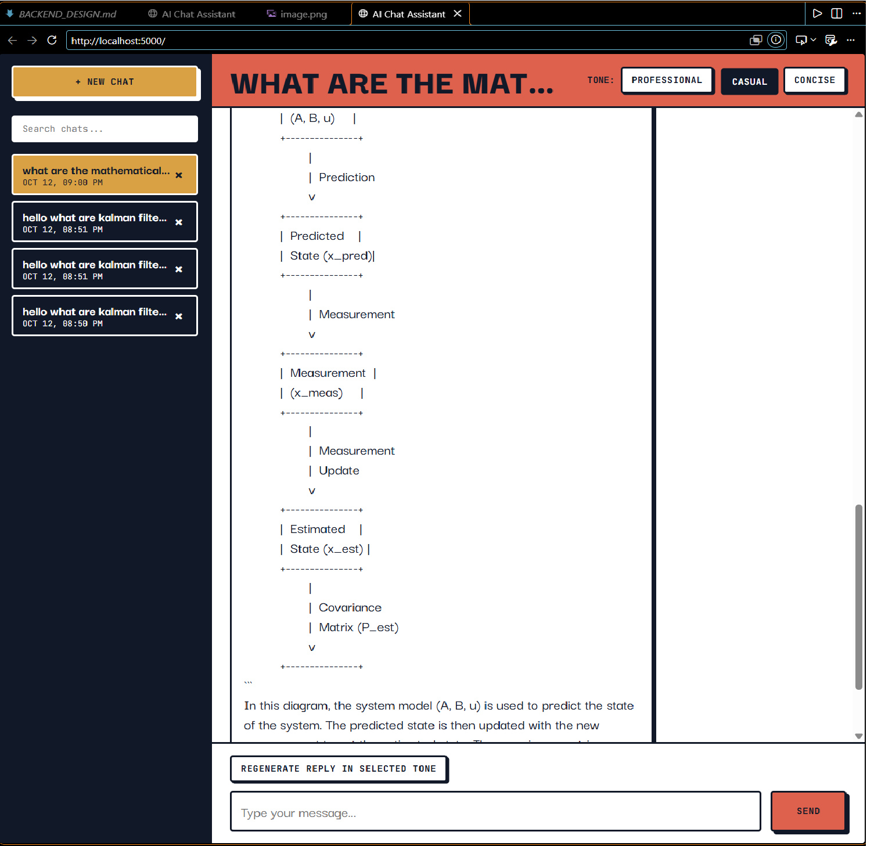

# quantiphi_round-shikhar

AI Chat Assistant: a chat app with streaming replies, saved history and a tone toggle.



- **Frontend:** plain HTML, CSS and JavaScript
- **Backend:** Node.js + Express
- **Database:** MongoDB (Mongoose)
- **AI:** OpenAI Chat Completions API (also works with NVIDIA's OpenAI-compatible API)

## Alternative design: brutalism theme

A second version of the frontend lives in the [`brutalism-ui`](https://github.com/shikharuniyal/quantiphi_round-shikhar/tree/brutalism-ui) branch. It has a bold "brutalism" look: thick black borders, hard shadows, flat colors and big uppercase type.

Only the styling is different. The backend, the features and the way you use the app are exactly the same as in `main`.

Reply streaming in:



A finished chat, opened from the history sidebar:



### How to use the brutalism version

1. Switch to the branch:

   ```
   git checkout brutalism-ui
   ```

2. Start the app the normal way (see "How to run" below). If the server is already running, there is no need to restart it.
3. Open `http://localhost:5000` and press Ctrl+F5 to load the new styles.

To go back to the default design, run `git checkout main` and press Ctrl+F5 again.

The theme loads its fonts (Darker Grotesque and JetBrains Mono) from Google Fonts, so it needs an internet connection to look right.

## Features

| Requirement | How it is done |
|-------------|----------------|
| Chat interface | Scrollable view, user bubbles on the right (blue), AI bubbles on the left (white) |
| Streaming view | Backend streams the AI reply over SSE; the frontend types it character by character |
| History sidebar | Past chats listed newest first; click one to open it |
| API integration | Backend calls `POST /v1/chat/completions` with `stream: true` |
| Persistence | MongoDB stores each conversation with user prompt, AI response and timestamps |
| Tone toggle | Professional / Casual / Concise. Backend turns the tone into the `system` message of the AI request |

### Two extra features

1. **Regenerate reply:** rewrites the last AI answer. Change the tone first to get the same answer in a different style.
2. **Search chats:** the search box filters the history by title or by any message text. The search runs on the server.

All logic (validation, tone mapping, search, building the AI request, saving) is on the server. The frontend only shows data and handles clicks.

## How to run

You need Node.js and MongoDB.

### 1. Start MongoDB

It must be running on `localhost:27017`.

- If MongoDB is installed as a service, it is already running.
- On the author's machine, double-click `start-mongo.bat` and keep the window open.

### 2. Add the API key

Copy `backend/secrets/secrets.example.json` to `backend/secrets/secrets.json` and put in your key:

```json
{
  "openaiApiKey": "sk-...",
  "mongoUri": "mongodb://127.0.0.1:27017/quantiphi_chat",
  "useMockAI": false
}
```

`secrets.json` is in `.gitignore`, so the key is never pushed. The key stays on the server and is never sent to the browser.

### 3. Install and start

```
cd backend
npm install
npm start
```

### 4. Open the app

Go to `http://localhost:5000` in the browser.

## Changing the AI provider

Only the key needs to change. The backend picks the provider from the key:

| Key starts with | Provider | URL used | Model used |
|-----------------|----------|----------|------------|
| `sk-` (or anything else) | OpenAI | `https://api.openai.com/v1` | `gpt-4o-mini` |
| `nvapi-` | NVIDIA | `https://integrate.api.nvidia.com/v1` | `meta/llama-3.2-11b-vision-instruct` |

Put the new key in `secrets.json` and restart the server.

To use a different model or another OpenAI-compatible provider, add these optional lines to `secrets.json`:

```json
"openaiBaseUrl": "https://...",
"openaiModel": "model-name"
```

Set `"useMockAI": true` to try the app with no key at all. Replies are then canned text marked "Demo mode".

## How to use

1. **Pick a tone** at the top right: Professional, Casual or Concise.
2. **Type a message** and press Enter (Shift+Enter for a new line).
3. **Watch the reply** type itself out as it streams in.
4. **Change the tone** any time. The next reply uses the new tone.
5. **Regenerate:** click "Regenerate reply in selected tone" to rewrite the last answer.
6. **History:** click a chat in the sidebar to open it again. Chats stay saved after a restart.
7. **Search:** type in the search box to filter chats.
8. **Delete:** click the × next to a chat.
9. **New chat:** click "+ New chat".

## Project structure

```
backend/
  server.js               starts Express, connects MongoDB, serves the frontend
  config/config.js        reads secrets and holds settings
  secrets/                API key and DB url (secrets.json is not committed)
  models/Conversation.js  MongoDB schema
  routes/chat.js          POST /api/chat, POST /api/chat/regenerate
  routes/conversations.js list, search, load, delete
  services/openai.js      AI streaming call
  services/tone.js        tone -> system instruction
  services/mockAI.js      demo mode for testing without a key
frontend/
  index.html
  css/style.css
  js/api.js               all calls to the backend
  js/app.js               page logic
BACKEND_DESIGN.md         design notes and diagrams
```

## API

| Method | Route | Purpose |
|--------|-------|---------|
| GET | `/api/health` | Server check |
| GET | `/api/tones` | List of tones |
| POST | `/api/chat` | Send a message, stream the reply |
| POST | `/api/chat/regenerate` | Rewrite the last reply |
| GET | `/api/conversations?q=` | List chats, optional search |
| GET | `/api/conversations/:id` | One full chat |
| DELETE | `/api/conversations/:id` | Delete a chat |

More detail is in [backend/README.md](backend/README.md) and [BACKEND_DESIGN.md](BACKEND_DESIGN.md).
